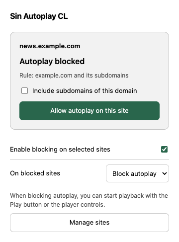
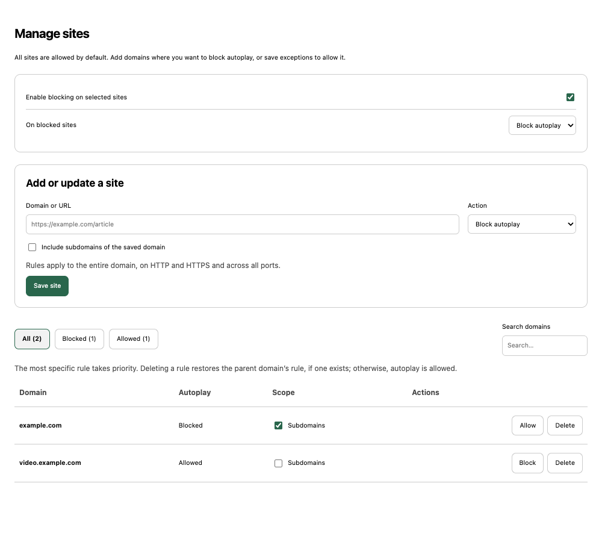

# Sin Autoplay CL

It really bothers me how many websites disregard their users and autoplay videos without asking, especially news sites and media outlets. Opening an article shouldn't mean having a video start playing on its own.

Sin Autoplay CL is simply a tool to help users stay in control of what they watch on the internet. You decide when a video plays.

## What it does

Sin Autoplay CL is a Manifest V3 browser extension that allows autoplay by default. You choose which sites should have automatic video and audio playback blocked. On those sites, you can still start playback manually. Embedded players follow the rule for the top-level site you are visiting.

From the extension's popup, you can:

- Block or allow autoplay on the current site without reloading the page.
- Choose whether that site's rule also covers its subdomains.
- Pause blocking globally while keeping your saved rules.
- Keep players visible or hide them on blocked sites.
- Open **Manage sites** to manage the blocked and allowed lists.

The management panel lets you add a hostname or an HTTP/HTTPS URL, search saved sites, change their action or subdomain scope, and delete rules. It previews the hostname that will be saved. Paths, query strings, schemes, and ports do not narrow a rule: it applies to the whole hostname on both HTTP and HTTPS, across all ports.

Unlisted sites are implicitly allowed; the extension does not keep a list of sites you visit. Rules target an exact hostname unless you select **Include subdomains**. `www.example.com` and `example.com` are separate hostnames. The most specific matching hostname wins, so you can block `example.com` and its subdomains while allowing `video.example.com`. Deleting an exception restores any matching parent rule, or the default allowed state if there is none.

Saved preferences and rules use Chrome sync storage, which can sync them across browsers signed into the same account when browser sync is enabled. Save failures are displayed so you can retry. Allowing a site means the extension does not block it; the browser's own autoplay policy still applies.

In blocking mode, use the player's Play button or native media controls to start playback. Enter and Space also work with accessible controls. Permission stays with the same media through pauses and playback retries; changing the source requires another interaction.

Blocking a site pauses automatic playback already in progress and preserves playback you started manually. Allowing it or pausing the extension restores the `autoplay` and `preload` attributes changed by the extension. Hiding players is optional and applies only to blocked sites; switch back to blocking autoplay to use their controls.

When updating from version 1.0, existing allowed sites retain their subdomain scope, and the global switch and display mode are preserved. The blocklist starts empty. A notice explains the new default and can be dismissed.

## Languages

The popup and management panel support English and Spanish. The extension follows the browser's interface language automatically, including regional variants such as British English and Latin American Spanish. Other browser languages fall back to English. There is no separate language setting in the extension.

Labels, accessibility text, validation messages, and the extension description use the same translation catalogs. Unexpected browser or storage errors include a translated explanation followed by the original technical detail, which may be in another language.

Version 1.2 adds these translations without changing saved rules or preferences. The name **Sin Autoplay CL** stays the same in both languages.

The popup and management panel in English, using example domains:





## Installation

1. Open `chrome://extensions` and enable **Developer mode**.
2. Click **Load unpacked** and select this repository's folder.
3. Open or reload the pages where you want to use the extension.

After updating the code, reload the extension and any open tabs so they receive the updated scripts.

## Limitations

Settings are read asynchronously. While they load, the extension allows playback and leaves media attributes alone. Very early autoplay can therefore start briefly on a blocked site before its rule arrives; unauthorized playback is then stopped. Storage read failures also leave sites allowed.

Hiding or pausing a player does not guarantee that the website stops downloading media. Some custom players may need changes to how the extension recognizes their controls.

The code running in the page's `MAIN` world shares its environment with the website. The extension prevents the bypasses covered by its tests, but it is not a security boundary against a page that modifies other native APIs.

## Running the tests

Requirements: Node.js 20 or later and Playwright's Chromium.

```sh
npm ci
npx playwright install chromium
npm run check
npm test
```

You can also use an existing Chromium installation:

```sh
CHROMIUM_EXECUTABLE="/path/to/chromium" npm test
```

The browser tests load the extension into a temporary Chromium profile, serve silent PCM media from a local server, and use real mouse and keyboard input. Browser autoplay restrictions are disabled during testing so that blocking can be attributed to the extension. Popup tests simulate the active-tab URL normally granted by a toolbar click; settings writes, the service worker, and media playback use the installed extension. Separate tests simulate delayed configuration and storage failures.

Coverage includes the default allowed state, popup and panel actions, URL validation, rule precedence, migration, concurrent edits, save failures, HTML and JavaScript autoplay, synthetic events, manual and native controls, playback retries, source changes, audio, iframes, Shadow DOM, visibility modes, and live configuration changes.

Tests run with the browser UI in English by default. To test Spanish and the English fallback for French, run:

```sh
TEST_LOCALE=es npm test
TEST_LOCALE=fr npm test
```

These commands use POSIX shell syntax. `CHROMIUM_EXECUTABLE` can be combined with `TEST_LOCALE` when using an existing browser. The test launcher uses temporary profiles and sets the language for that process only, including on macOS; it does not change system language preferences. Tests verify the language reported by `chrome.i18n` before exercising the interface. Catalog checks also cover missing messages and mismatched placeholders.

Set `CAPTURE_UI=1` to save popup, management panel, and narrow-window screenshots under `output/playwright/<locale>/` during the browser tests.

## Contributing translations

Translations live in `_locales/en/messages.json` and `_locales/es/messages.json`. To add a language, copy the English catalog into `_locales/<locale>/messages.json`, using a [locale supported by Chrome](https://developer.chrome.com/docs/extensions/reference/api/i18n#locales).

Translate each `message`, keep the message keys and `placeholders` definitions unchanged, and set the `uiLanguage` message to the language tag used by HTML (for example, `pt-BR` for a `pt_BR` directory). Descriptions and placeholder examples explain the context. Keep **Sin Autoplay CL** as the product name.

Use complete sentences for messages containing a hostname or count. Preserve tokens such as `$host$` and `$count$`; their position can change to fit the language. UI text is inserted as plain text, so translations should not contain HTML.

When adding a new interface message, add it to every catalog. Run `npm run check` and `npm test`, then inspect both screens in the target browser language, including errors and narrow windows. The English catalog is the fallback, but supported translations should remain complete. For a new language, also extend the expected catalog selection in `tests/browser.cjs` and the literal translation checks in `tests/autoplay.test.cjs`.

## Project structure

- `content.js` reads `chrome.storage.sync` in the isolated world and updates the attributes used by the CSS.
- `site-policy.js` normalizes hostnames and resolves site rules. `settings.js` shares storage reads, change notifications, and write requests between the popup and panel.
- `background.js` migrates old preferences and serializes settings writes. Each hostname has its own storage entry, so editing one site does not rewrite other rules.
- `main-world.js` intercepts playback APIs and observes media elements. It receives preferences through a `MessagePort` transferred at startup and consumed before the page's listeners receive it. Changing the `<html>` attributes does not change the blocking state.
- `content.css` contains the rules for hiding players.
- `popup.js` and `popup.html` control the current site. `options.js` and `options.html` provide the management panel; both use `ui.css`.
- `i18n.js` localizes both UI pages using Chrome's native message catalogs in `_locales/`. Policy and worker errors use stable codes that the UI translates.
- `tests/autoplay.test.cjs` exercises the installed extension, media engine, and translated UI. `tests/site-policy.test.cjs` and `tests/settings.test.cjs` check rule resolution and persistence; `tests/i18n.test.cjs` checks catalogs and error translation.
